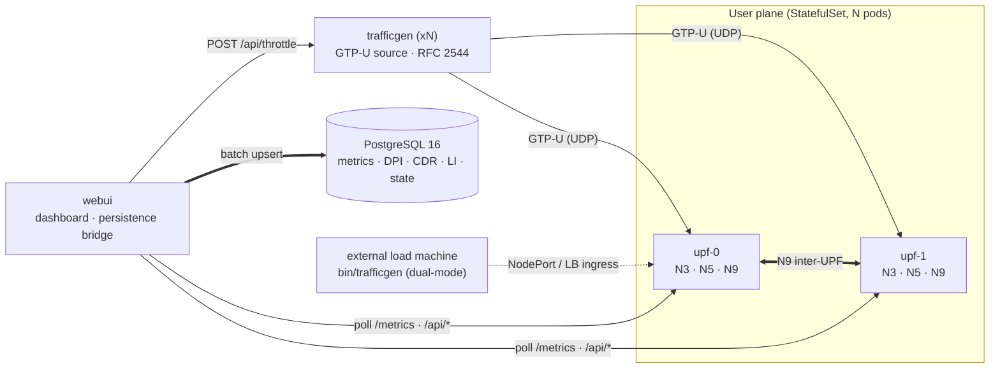
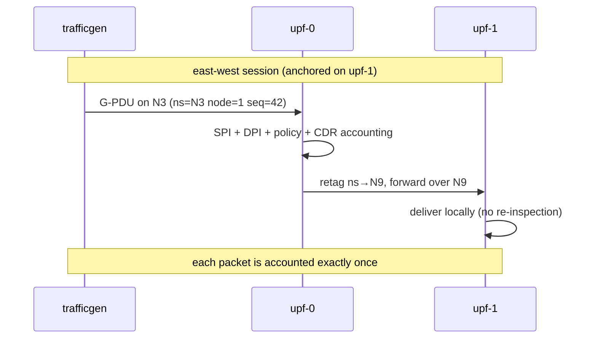

# telco-upf-gen

A distributed **5G UPF (User Plane Function) simulator** for OpenShift.
Native **GTP-U** (3GPP TS 29.281 / RFC 8180) encapsulation and decapsulation
across simulated **N3** (UE/gNB), **N5** (data-network) and **N9** (inter-UPF)
interfaces, deep packet inspection (SPI/DPI + policy), telco **usage**
analytics (CDRs and a lawful-interception feed), an **RFC 2544-style** load
generator (with a live 0–100 % throttle knob), and a real-time **Web UI**
backed by **PostgreSQL**.

Everything is **environment-agnostic**: no cluster names, IPs or paths are
hard-coded. All configuration flows from YAML, ConfigMaps and environment
variables, and the whole build / push / deploy / test pipeline is driven by a
single `Makefile`.

> **Architecture deep-dive:** see [`docs/architecture.md`](docs/architecture.md)
> — every diagram in this repo is authored in native **Mermaid** (no external
> images).

---

## System overview



| Component | Role |
|---|---|
| **UPF** (`cmd/upf`) | The data plane. StatefulSet pod per node; decodes F-TEIDs, inspects every packet (SPI/DPI/policy), accounts usage, and forwards across the fabric over N9. |
| **Traffic generator** (`cmd/trafficgen`) | Token-bucket GTP-U flows with realistic mock payloads (HTTP/SNI/DNS/QUIC). Dual-mode: in-cluster *or* external machine. Live 0–100 % throttle; **RFC 2544 benchmark runner** (loss ladder, throughput bisection, latency, back-to-back) on the live fabric. |
| **Web UI** (`cmd/webui`) | Live dashboard + RFC 2544 panel (charts read the DB rows); the **sole** PostgreSQL writer (metrics, SPI/DPI, CDRs, LI, bench results, UI state). State restored from the DB on refresh — zero data loss. |
| **Database** (PostgreSQL 16) | Durable store for all analytics and UI state, on a PVC. |

The data plane never touches the database — reports flow `UPF → webui → DB`,
so a database outage can delay *reporting* but never stalls *forwarding*.

---

## Quick start

```bash
# one-time: credentials + cluster access
export QUAY_PASSWORD=***
export KUBECONFIG=/path/to/kubeconfig      # e.g. your SNO admin kubeconfig

make                # menu of all targets
make build          # Go binaries + UBI9 Podman images
make push           # login to Quay (QUAY_USERNAME/QUAY_PASSWORD) + push
make deploy         # oc apply -f deploy/ against $KUBECONFIG
make deploy-multus  # optional: attach UPF+TG pods to secondary Multus networks
make e2e            # live-cluster end-to-end suite
export E2E_EXTERNAL_ADDR=<node-ip>:32152 && make e2e   # adds the cross-CNI
                                    # NodePort-ingress check (svc upf-ext)
```

> The `db` StatefulSet (`deploy/db.yaml`) uses the
> `registry.redhat.io/rhel9/postgresql-16` image; if the cluster pull secret
> does not cover `registry.redhat.io`, attach one to the `telco` service
> accounts or point that image at a mirror. The webui's `DB_DSN`
> (`deploy/webui.yaml`) must stay in sync with the DB envs in
> `deploy/db.yaml` — the `make e2e` defaults (`E2E_DB_*`) match both.

Useful local-only flows:

```bash
make test           # go test ./... (unit + integration)
make lint           # gofmt check + go vet (+ staticcheck when installed)
make test-local     # full stack under podman: Postgres + 2 UPF + TG + webui
make local-logs     # tail everything
make local-down     # tear down the local stack
```

`make test-local` pulls the RHEL9 PostgreSQL image on demand; when the local
portal credentials are stale, point it at any pull secret with working
`registry.redhat.io` auth (the cluster pull secret works):

```bash
make test-local DB_AUTHFILE=~/pull-secrets/cluster.json
```

then open `http://127.0.0.1:3080` (webui) and `http://127.0.0.1:3081`
(generator API). Press **Start** in the RFC 2544 panel — results are
upserted into Postgres with verified persistence and the four charts render
from those rows. The full walkthrough, with one rendered proof per step,
lives in [`docs/podman-demo.md`](docs/podman-demo.md).

### Required environment variables

| Variable | Consumed by | Purpose |
|---|---|---|
| `QUAY_USERNAME` | `make push` | Quay user (default `midu`, override: `make push IMAGE_OWNER=you`) |
| `QUAY_PASSWORD` | `make push` / `make login` | Quay token or password (never stored; temp authfile) |
| `KUBECONFIG` | `make deploy` / `e2e` / `pods` / `undeploy` | kubeconfig of the target cluster |
| `NAMESPACE` (opt) | deploy / e2e | OpenShift namespace (default `telco`) |
| `IMAGE_REGISTRY` / `IMAGE_OWNER` / `TAG` (opt) | build / push | image reference parts |
| `PLATFORMS` (opt) | build / push | e.g. `linux/amd64,linux/arm64` for a multi-arch manifest |
| `COMPONENTS` (opt) | build / push / images | subset, e.g. `upf trafficgen` |
| `DB_AUTHFILE` (opt) | `make test-local` (DB pull) | authfile for pulling the RHEL9 PostgreSQL image |
| `E2E_EXTERNAL_ADDR` (opt) | `make e2e` | `<node-ip>:<n3NodePort>` — drives real G-PDUs into the `upf-ext` NodePort ingress (cross-CNI check). Omit = check skipped |
| `DB_IMAGE` / `DB_USER` / `DB_PASSWORD` / `DB_NAME` (opt) | `make test-local` | local stack DB image and credentials (user default `upfgen`) |

---

## The traffic fabric in one picture

Each node is a stateless UPF: session identity is encoded into the F-TEID
(`namespace<<24 | node<<16 | seq`), so any node can route a packet without a
control plane. Packets anchored on a *peer* node are retagged into the N9
namespace and crossed the fabric.



The traffic generator emits anchored N3 (uplink), anchored N5 (downlink) and
all three east-west shapes, so every forwarding branch runs continuously.
Inner payloads are wire-valid IPv4/TCP/UDP with real checksums, each flow
emulating HTTP, HTTPS (ClientHello with SNI), DNS, QUIC or plain UDP — so the
DPI dashboard shows genuine app classification.

---

## Usage analytics

* **CDRs** — per-session billing records (UL/DL packets & bytes, per-app
  breakdown, duration), closed after an idle window and upserted
  idempotently into Postgres.
* **Lawful-interception feed** — per-packet header records for a configurable
  session selector, bounded by a ring.
* **Policy events** — every `observe`/`drop` decision with rule + 5-tuple.
* **Metrics** — per-`(pod, iface)` counters and rates at a fixed cadence.
* **RFC 2544 results** — every measurement point of every benchmark run, with
  verify-then-seen persistence (a dropped write batch self-heals on the next
  poll instead of losing the run).

All of it is browsable in the Web UI, and every widget re-reads from the
database on refresh — including the RFC 2544 charts (loss vs offered rate,
zero-loss throughput, one-way latency, back-to-back), which render from the
stored rows of the runs you trigger from the panel or a
`POST /api/rfc2544`.

---

## Repository layout

```
cmd/            upf · trafficgen · webui · e2e          (entrypoints)
internal/       gtpu · upf · dpi · usage · traffic      (data plane + codecs + RFC 2544)
                telemetry · web · dbstore               (metrics, UI, store)
deploy/         OpenShift manifests (namespace, SCC, STS, Deployments,
                Services, Route, PVC, ConfigMaps)
local/          example YAML (local TG, external TG, policy profile)
docs/           architecture.md + podman-demo.md (Mermaid + rendered proofs)
Makefile        all podman + oc automation   (*.Containerfile: UBI9 per component)
.github/        build-and-push CI (test gate + parallel image matrix)
```

Full package-by-package notes, the data-plane pipeline, the DB schema (er
diagram) and the RFC 2544 design live in
[`docs/architecture.md`](docs/architecture.md).
