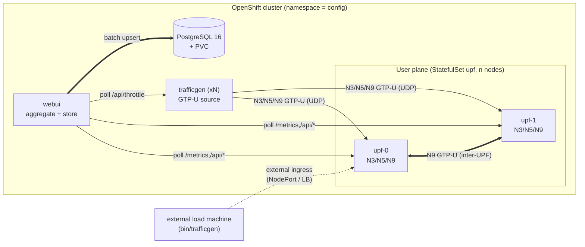
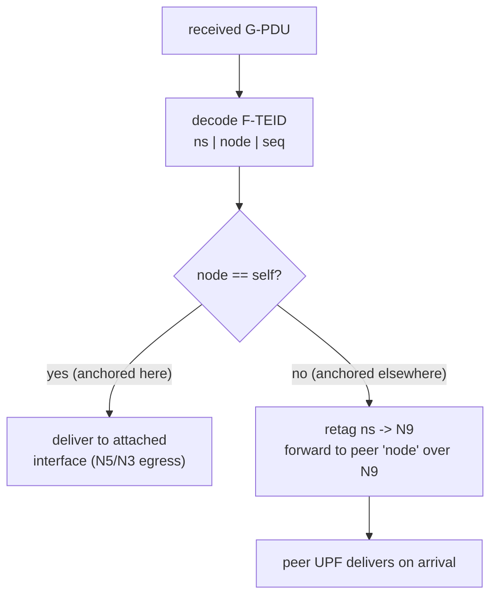
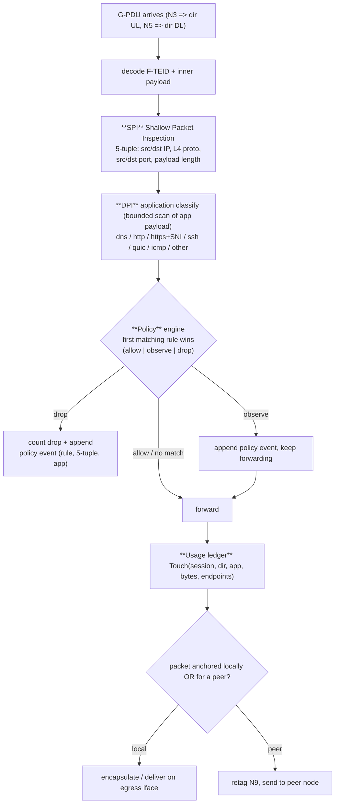
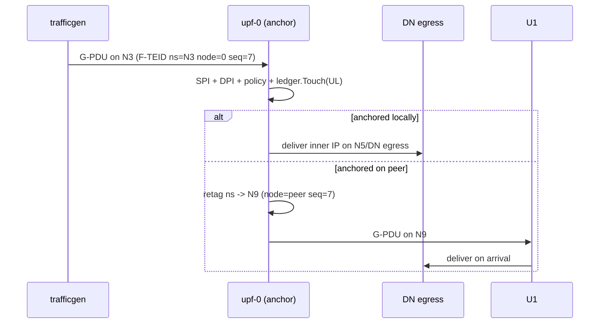
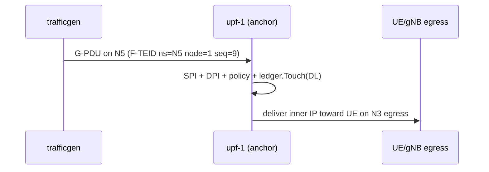
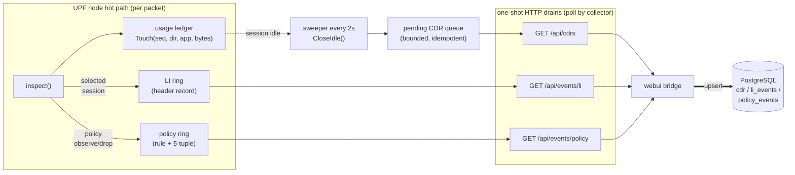
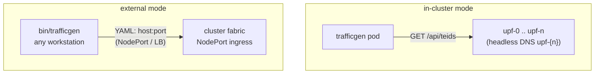
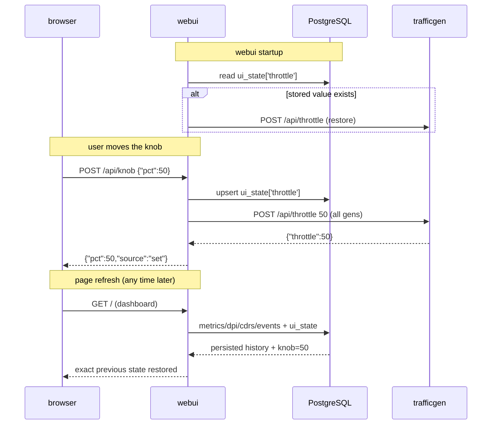
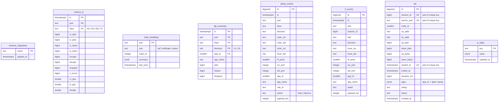
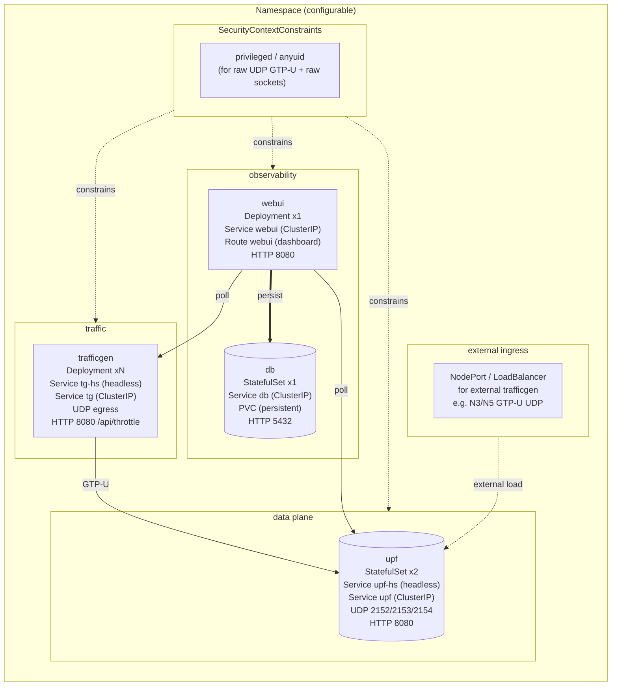

# telco-upf-gen — Architecture

A distributed 5G **User Plane Function (UPF)** simulator that runs as a set of
pods on OpenShift. It fabricates realistic **GTP-U** user-plane traffic across
the 3GPP reference points **N3** (gNB/UE direction), **N5** (data-network / DN
direction) and **N9** (inter-UPF), inspects every packet on the data plane
(SPI + DPI), produces telco-grade **usage** records (CDRs and a
lawful-interception feed), and visualizes the whole flow in a real-time Web UI
backed by PostgreSQL.

This document is the single source of truth for *how the system is shaped*.
The running code lives in `internal/` and `cmd/`; the manifests live in
`deploy/`. All diagrams below are authored in **Mermaid** so they render in
any GitHub/Markdown viewer without external image dependencies.

---

## 0. Design goals

| Goal | How it is met |
|---|---|
| **Distributed** | Each UPF node is one pod in a `StatefulSet`. Nodes form a fabric and forward to each other over N9. There is no master. |
| **Environment-agnostic** | No cluster name, IP, or path is hard-coded. Everything is YAML / ConfigMap / env var. The traffic generator can run in-cluster *or* on an external machine. |
| **Realistic wire format** | Native GTP-U (GTPv1-U, 3GPP TS 29.281 / RFC 8180) encode/decode, not a stand-in. |
| **Inspectable** | A per-packet SPI/DPI/policy/usage pipeline runs in the forwarding hot path. |
| **Billable & auditable** | Per-session CDRs and a lawful-interception event feed, persisted durably. |
| **Observable** | A webui aggregates every pod, keeps state in Postgres (survives refresh), and exposes a live "throttle" knob. |
| **Load-testable** | The traffic generator doubles as an RFC 2544 benchmarking suite (throughput / latency / loss / back-to-back). |

---

## 1. Component map

There are four deployable units, each a separate Go main and a separate
Containerfile.

| Component | Binary | Role | Scaled as |
|---|---|---|---|
| **UPF** | `cmd/upf` | The data plane. Listens for GTP-U on N3/N5/N9, resolves F-TEIDs, inspects (SPI/DPI/policy/CDR) and forwards across the fabric. | `StatefulSet` (1 pod per logical node) |
| **Traffic generator** | `cmd/trafficgen` | Emits token-bucket GTP-U flows into the fabric's ingress ports; carries realistic mock payloads for DPI. Dual-mode (in-cluster / external). | `Deployment` (N pods) — or a standalone binary |
| **Web UI** | `cmd/webui` | Fans out to every pod, renders the dashboard, and is the **only** process that writes to Postgres (metrics, SPI/DPI, CDRs, LI, UI state). | `Deployment` (1) |
| **Database** | PostgreSQL 16 | Durable store for metrics, inspection results, usage and UI state. | `StatefulSet` (1) + PVC |



The webui is deliberately the **sole DB writer**. The data plane (UPF) and the
traffic generator never open a database connection, so a database outage can
only delay *reporting* — it can never stall *data flow*.

---

## 2. The F-TEID addressing scheme

There is **no control plane** and no signalling (no PFCP, no GTP-C). Session
identity is encoded directly into the 4-octet **Fully-qualified TUNNEL Endpoint
Identifier (F-TEID)** so that any node can decode a packet's destination and
path *without* consulting a map. This is what makes the fabric stateless and
horizontally scalable.

```
F-TEID (32 bits)
┌──────────┬──────────┬───────────────────┐
│   ns     │  node    │      seq          │
│ 8 bit    │  8 bit   │       16 bit      │
└──────────┴──────────┴───────────────────┘
  ns<<24 | node<<16 | seq
```

The **namespace** byte selects the reference point (which ingress interface
the tunnel belongs to):

| Namespace | Value | Reference point | Direction |
|---|---|---|---|
| `TeidNSN3` | `0x10` | **N3** | UE / gNB → UPF (uplink) |
| `TeidNSN5` | `0x20` | **N5** | DN → UPF (downlink, from data network) |
| `TeidNSN9` | `0x40` | **N9** | peer-UPF → UPF (east-west transit) |

| Field | Bits | Meaning |
|---|---|---|
| `ns` | 24..31 | Which interface/namespace the tunnel was announced on. |
| `node` | 16..23 | The logical UPF node that *anchors* this session (0..255). |
| `seq` | 0..15 | Session sequence within a node (0..65535). |

Two worked examples (straight from `internal/upf/session_test.go`):

```
0x10 03 1234  ->  ns=N3(0x10), node=3, seq=0x1234   (Uplink to node 3)
0x40 01 002a  ->  ns=N9(0x40), node=1, seq=0x2a     (N9 transit to node 1)
```

**Consequence:** when a packet arrives whose `node` field names a *different*
UPF, the receiving node retags the tunnel into the **N9 namespace** (same
`node`/`seq`) and hands it to that peer. That is the entire east-west (E-W)
mechanism — no lookup, no state, O(1).



---

## 3. GTP-U wire format

The simulator implements the real **GTPv1-U** user-plane message (G-PDU,
3GPP TS 29.281 / RFC 8180). Codec lives in `internal/gtpu` with full
round-trip tests.

```
 0                   1                   2                   3
 0 1 2 3 4 5 6 7 8 9 0 1 2 3 4 5 6 7 8 9 0 1 2 3 4 5 6 7 8 9 0 1
+-+-+-+-+-+-+-+-+-+-+-+-+-+-+-+-+-+-+-+-+-+-+-+-+-+-+-+-+-+-+-+-+
|VER=1|T/U=1|  R |S|            |   255 (G-PDU) |  T-PDU length |
+-+-+-+-+-+-+-+-+-+-+-+-+-+-+-+-+-+-+-+-+-+-+-+-+-+-+-+-+-+-+-+-+
|                        Tunnel endpoint ID (F-TEID)           |
+-+-+-+-+-+-+-+-+-+-+-+-+-+-+-+-+-+-+-+-+-+-+-+-+-+-+-+-+-+-+-+-+
|  [optional] Seq Ext  T=4 |    SeqExtLen=4  |  E |  |  |  |seq|
+-+-+-+-+-+-+-+-+-+-+-+-+-+-+-+-+-+-+-+-+-+-+-+-+-+-+-+-+-+-+-+-+
|                        IPv4 user datagram                     |
~                                                               ~
+-+-+-+-+-+-+-+-+-+-+-+-+-+-+-+-+-+-+-+-+-+-+-+-+-+-+-+-+-+-+-+-+
```

| Octet | Field | Notes |
|---|---|---|
| 0 | `VER=001, T/U=1` | fixed `0x30`; bit 2 (`S`) set iff a sequence extension follows |
| 1 | Message type | `0xFF` = G-PDU |
| 2–3 | T-PDU length | big-endian, length of everything after the 4th octet |
| 4–7 | **F-TEID** | the addressing scheme of §2 |
| 8–13 | Sequence extension *(optional)* | type `4`, present on alternating packets to exercise the full decoder |
| 14+ | Inner IPv4 datagram | a *real* user packet (see §7 mock payloads) |

---

## 4. The per-packet data plane

Every G-PDU accepted at an **ingress** interface (N3 = uplink, N5 = downlink)
passes through one inspection pipeline *before* forwarding. N9 is pure
transit: packets crossing between nodes are never re-inspected or re-counted,
which guarantees each user packet is accounted **exactly once** — by the node
that saw it on N3/N5.



* **SPI** (`internal/dpi/spi.go`) is a fixed-cost header parse. It never reads
  payload bytes, so it can run at line rate on every packet.
* **DPI** (`internal/dpi/apps.go`) is a *bounded* classification — only the
  first N octets of the application payload are scanned, and only for the
  few app signatures that matter. It is allocation-light on purpose because it
  runs in the forwarding workers.
* **Policy** (`internal/dpi/policy.go`) is an ordered rule list loaded from
  YAML (ConfigMap-mounted per cluster). First match wins; no match = allow.
  Rules match on the SPI 5-tuple and the app class.
* **Aggregation** is sharded: per-interface/per-app counters live in striped
  buckets so the hot path takes a lock only for its own shard.

App classes detected by DPI:

| AppID | Name | Signature |
|---|---|---|
| 0 | unknown | unparseable inner datagram |
| 1 | other | recognised transport, no known app signature |
| 2 | icmp | IP proto 1 |
| 3 | dns | UDP :53, valid query — QNAME extracted for detail |
| 4 | http | TCP :80, request line — `GET /path` extracted |
| 5 | https | TCP :443, TLS ClientHello — **SNI** extracted |
| 6 | ssh | TCP :22 banner |
| 7 | quic | UDP, QUIC long-header first byte |

---

## 5. Traffic sequences

### 5.1 Uplink (N3) — session anchored locally



### 5.2 Downlink (N5) — traffic injected from the DN side



### 5.3 East-west (E-W) — anchored on a peer node

```mermaid
sequenceDiagram
  participant TG as trafficgen
  participant A as upf-0 (ingress)
  participant B as upf-1 (anchor)
  TG->>A: G-PDU on N3 (ns=N3 node=1 seq=42)
  A->>A: inspect, ledger.Touch(UL); node(1) != self -> retag N9
  A->>B: G-PDU on N9 (ns=N9 node=1 seq=42)
  B->>B: node == self -> deliver on egress (no re-inspect)
```

The traffic generator emits all three shapes: anchored N3, anchored N5, and
E-W via N3-ingress / N5-ingress / direct-N9, so every data-plane branch is
exercised continuously.

---

## 6. Usage analytics: CDRs and Lawful Interception

Two independent usage feeds come off the data plane:

### 6.1 CDRs (Call Detail Records) — billing-shaped, per session

Sessions are keyed by F-TEID sequence. A session is *closed* when it stays
idle for `UPF_CDR_IDLE` (default 15 s, configurable per node) after living at
least `UPF_CDR_MIN`. A closed CDR carries the full accounting for the session:

| CDR field | Meaning |
|---|---|
| `sessionId`, `nodeId`, `anchorPod` | identity of the session and the node that accounted it |
| `ueAddr`, `dnAddr` | first-seen inner UE / DN endpoints |
| `upPkts/upBytes`, `downPkts/downBytes` | per-direction volume (UL on N3, DL on N5) |
| `startedAt`, `endedAt`, `durationMs` | session lifetime |
| `apps` | per-app breakdown `{"<app_id>": [pkts, bytes]}` |
| `rating`, `status` | simulated rating state (`sim-rated`, `closed`) |

The ledger is sharded and bounded: the pending-CDR queue is capped
(oldest dropped first) so a long collector outage cannot grow memory
without limit, and CDRs **upsert idempotently** on `(session_id, anchor_pod,
started_at)` — re-reporting a closed CDR is always safe.

### 6.2 Lawful-Interception (LI) feed

A configurable session *selector* (`UPF_LI_SESSIONS`, e.g. `0-7,42`) chooses
which sessions emit per-packet header records (5-tuple, app, detail such as
SNI/QNAME) into a bounded ring. This simulates an LI capture without storing
payloads. Policy actions (`observe`/`drop`) emit their own event stream with
the matching rule.



The drain endpoints are **one-shot** (they return and clear the buffer): the
webui bridge polls them every `WEBUI_AGG_INTERVAL` (default 5 s) and persists
the results. A dead webui therefore only delays reporting; the data plane
keeps forwarding, and CDRs re-report safely on the next drain.

---

## 7. The traffic generator

`internal/traffic` implements a **token-bucket** generator: every flow
accumulates credits at `pps × throttle%` and emits packets on a fixed tick
(`interval_ms`, default 20 ms). The output level is an atomic knob changeable
at runtime from 0–100 %.

### 7.1 Flow model

For every UPF node the generator dials in:

* **anchored** flows — N3 (UL) and N5 (DL) using that node's own namespace;
* **east-west** flows — sessions anchored on a *peer* node, injected here via
  N3, via N5, or direct on N9 (mix chosen per session).

Each flow is one UDP egress socket to `host:port` of the target interface.
Flows share sockets per destination where possible.

### 7.2 Dynamic throttle (0–100 %)

```
GET  /api/throttle        -> {"throttle":75}
POST /api/throttle  body: 75      or {"throttle":75}   (clamped to 0..100)
```

The knob takes effect on the next token tick — no restart. The webui exposes
the same knob as a UI slider and persists its position in Postgres (`ui_state`)
so a page refresh restores the exact level, and re-applies it to every
generator on webui startup.

### 7.3 Realistic mock payloads (for honest DPI)

Inner datagrams are **wire-valid IPv4** with computed IP/TCP/UDP checksums, so
the UPF's SPI/DPI classifies genuine-looking traffic. Each flow emulates one
application (chosen from the F-TEID), and per-packet fields (DNS txid, HTTP
path, TCP/QUIC counters) vary with the packet sequence:

| Mock app | Inner stack | DPI result |
|---|---|---|
| HTTP | IPv4 → TCP :80, `GET /page-NNNNN` + Host | `http`, path in detail |
| HTTPS | IPv4 → TCP :443, truncated **TLS 1.2 ClientHello** with SNI | `https`, SNI in detail |
| DNS | IPv4 → UDP :53, A-record query | `dns`, QNAME in detail |
| QUIC | IPv4 → UDP :443, QUIC v1 long header | `quic` |
| other | IPv4 → UDP, incrementing pattern | `other` |

### 7.4 Dual deployment mode

The *same binary/container* runs in two modes, selected by YAML:

| Mode | Trigger | Endpoint source |
|---|---|---|
| **in-cluster** | `discover:` (or default) | each node's `/api/teids` over headless StatefulSet DNS (`{n}` = ordinal) |
| **external** | `upf:` list non-empty | explicit `host + node + sessions + ports` (IP:NodePort works); discovery skipped |



Example external config (`local/trafficgen-external.yaml`):

```yaml
name: trafficgen-ext-0
interval_ms: 20
pps: 100
throttle: 50
upf:
  - host: 192.0.2.10        # cluster / NodePort address
    node: 0
    sessions: 64
    ports: { n3: 32152, n5: 32153, n9: 0 }
  - host: 192.0.2.10
    node: 1
    sessions: 64
    ports: { n3: 32152, n5: 32153, n9: 0 }
```

---

## 8. Web UI, aggregation and state persistence

The webui has two jobs: render the live dashboard, and act as the **persistence
bridge** for the whole fabric.

### 8.1 Live aggregation

Every few seconds the webui fans out over HTTP to each endpoint:

| Source | Endpoints polled | Purpose |
|---|---|---|
| UPF nodes | `/metrics`, `/api/teids`, `/api/dpi`, `/api/cdrs`, `/api/events/policy`, `/api/events/li` | counters, session info, DPI aggregates, one-shot drains |
| traffic generators | `/metrics`, `/api/flows`, `/api/throttle` | TX counters, flow table, active knob |

The dashboard itself is served by the webui (`/`). It polls `/api/stats` and
`/api/topology` and renders the animated N3/N5/N9 fabric, per-interface rates
(pps, encaps/decaps, drops), aggregate charts and the pod fleet.

### 8.2 The bridge: fabric → Postgres

`internal/web/bridge.go` is the **only** component that writes to the
database. Each poll cycle it converts control-lite reports into store jobs:

* **metrics** — per-`(pod, iface)` counters plus rates computed from the
  previous snapshot → `metrics_ts`;
* **DPI aggregates** — engine counters are cumulative, so the bridge persists
  **deltas** between flushes (a counter reset, i.e. a pod restart, drops the
  baseline) → `dpi_summary`;
* **policy / LI events** — drained straight through → `policy_events`,
  `li_events`;
* **CDRs** — drained and upserted idempotently → `cdr`;
* **heartbeats** — liveness + a small config snapshot per pod →
  `node_heartbeat`.

Writes are batched and buffered inside the store, so a database blip delays
reporting but never blocks the poll loop or the data plane.

### 8.3 State retention — zero loss on refresh

The dashboard is **stateless**: on every load it re-derives its state from the
database (metrics history, DPI history, CDRs, events) and re-applies stored
UI state. The traffic-knob position lives in `ui_state`; on webui startup the
bridge reads it back and re-pushes it to every generator, so the exact previous
level survives a webui restart, a generator restart, or a browser refresh.



---

## 9. Database schema (PostgreSQL 14+)

The store is defined in `internal/dbstore/sql/001_init.sql` and applied
idempotently by `internal/dbstore` (tracked in `schema_migrations`). The webui
is the sole reader/writer.



Design notes worth calling out:

* **`metrics_ts`** and **`dpi_summary`** are keyed by `(…, ts)` and carry a
  dedicated `ts` index — they are the append-only time series the dashboards
  chart. `dpi_summary` stores *deltas*, so row count is bounded by
  `pods × ifaces × apps × intervals`, not by packets.
* **`policy_events`** is naturally low-rate (only policy hits land here).
* **`li_events`** is bounded by the LI selector scope.
* **`cdr`** has a `UNIQUE (session_id, anchor_pod, started_at)` so the
  idempotent upsert in the bridge is safe under re-reporting.
* **`ui_state`** is a tiny key/value JSONB table — the row that makes a
  browser refresh restore the exact previous knob position.

---

## 10. Configuration & environment-agnostic surface

Nothing about a target cluster is hard-coded. Every component is driven by
flags + environment (which the OpenShift manifests template from ConfigMaps),
and the traffic generator additionally takes a YAML file. The matrix below is
the authoritative reference.

| Variable | Default | Component | Meaning |
|---|---|---|---|
| `POD_NAME` | `upf-0` / `trafficgen-0` | upf, tg | node identity (ordinal drives the fabric) |
| `UPF_NODES` | `2` | upf, tg | total UPF nodes in the fabric |
| `UPF_PEER_DNS` | `upf-{n}.upf-hs.telco.svc.cluster.local` | upf, tg | peer DNS template (`{n}` = ordinal) |
| `N3_PORT` / `N5_PORT` / `N9_PORT` | `2152` / `2153` / `2154` | upf | GTP-U UDP listen ports |
| `UPF_SESSIONS` | `256` | upf | session space per node |
| `UPF_WORKERS` | `4` | upf | forwarding worker pool size |
| `DN_TARGET` | *(empty)* | upf | DN egress `host:port` for plain-IP delivery (empty = count only) |
| `UPF_INSPECTION` | `true` | upf | enable the SPI/DPI/policy/CDR pipeline |
| `UPF_POLICY` | *(empty)* | upf | policy rules file (YAML); empty = allow-all |
| `UPF_LI_SESSIONS` | `0-7` | upf | LI session selector, e.g. `0-7,42` |
| `UPF_LI_RING` | `1024` | upf | bounded event ring size |
| `UPF_CDR_IDLE` | `15s` | upf | idle window that closes a CDR |
| `UPF_CDR_MIN` | `1s` | upf | minimum session lifetime before a CDR closes |
| `TG_CONFIG` | *(empty)* | tg | YAML config path (in-cluster vs external) |
| `TG_METRICS` | `:8080` | tg | control HTTP address |
| `TG_PPS` | `100` | tg | per-flow target pps at 100 % (flag/env override) |
| `TG_MAX_SESSIONS` | `32` | tg | max sessions targeted per UPF node |
| `UPF_METRICS_PORT` | `8080` | tg | UPF control-lite port (discovery) |
| `ADDR` | `:8080` | webui | dashboard HTTP address |
| `UPF_ENDPOINTS` | *(empty)* | webui | `name=http://host:port,...` |
| `TG_ENDPOINTS` | *(empty)* | webui | `name=http://host:port,...` |
| `WEBUI_AGG_INTERVAL` | `5s` | webui | bridge poll cadence |
| `DB_DSN` | *(empty)* | webui | PostgreSQL DSN (empty = store disabled) |
| `DB_MAX_CONNS` / `DB_FLUSH_MS` / `DB_QUEUE` | `4` / `2000` / `1024` | webui | pool / flush interval / job queue |

Global orchestration variables consumed by the **Makefile** (not by the Go
binaries): `QUAY_USERNAME`, `QUAY_PASSWORD`, `KUBECONFIG`, plus overridables
`NAMESPACE`, `IMAGE_REGISTRY`, `IMAGE_OWNER`, `TAG`, `PLATFORMS`,
`COMPONENTS`, `DB_IMAGE`, `DB_USER`, `DB_PASSWORD`, `DB_NAME`.

---

## 11. Deployment topology (OpenShift)

All objects are rendered from `deploy/` via `make deploy` against
`$KUBECONFIG`. Names, ports and the image pull reference all come from
ConfigMaps / Makefile variables, so the same tree deploys to any cluster.



Key properties:

* **`upf`** is a `StatefulSet` because node identity (ordinal) is meaningful —
  it is baked into the F-TEID `node` field and into the headless DNS name that
  peers and the generator resolve.
* **GTP-U is UDP**, so the Services expose UDP on 2152/2153/2154. External
  load comes in through a NodePort/LoadBalancer service (the "external
  ingress" path) or by running `bin/trafficgen` off-cluster in *external* mode.
* A permissive **SCC** (anyuid / privileged) lets the pods open the raw UDP
  sockets and, where the platform allows, set socket buffers for the hot path.
* **`db`** is a single-replica `StatefulSet` with a **PVC** so the metrics /
  usage / state survive pod rescheduling and restarts.

---

## 12. RFC 2544 benchmarking (roadmap — Phase 2)

The traffic generator is designed to *double* as a native **RFC 2544**
frame-throughput / latency / loss / back-to-back benchmarking suite. The
throughput-generating engine, the token-bucket throttle, the per-flow
counters and the dual-mode addressing described here are the substrate that
the benchmark harness will sit on.

```mermaid
flowchart LR
  subgraph R2544["RFC 2544 harness (Phase 2)"]
    direction TB
    P["YAML test profile\nframe sizes, durations,\ncandidate rates"]
    T["**Throughput**\nbisection on offered rate\nuntil 0 loss"]
    L["**Latency**\nper-frame TX/RX timestamps\nmin/avg/max, distribution"]
    F["**Frame-loss rate**\noffered vs forwarded\n% vs rate curve"]
    B["**Back-to-back**\nburst at min inter-frame gap\nlongest lossless burst"]
    P --> T & L & F & B
    T & L & F & B --> O["results -> rfc2544_results\n(history in Postgres)"]
  end
  GEN["traffic generator\n(token-bucket, dual-mode)"] <== R2544
  UI["Web UI\nRFC 2544 dashboard\ntrigger + graphs"] <==> GEN
```

Planned behaviour, so the shape is fixed now even before implementation:

* **Throughput:** binary-search the offered rate at a fixed frame size,
  reporting the maximum rate with *zero* dropped frames.
* **Latency:** stamp frames at injection and (via an anchored return path) at
  receipt, producing min/mean/max and a per-size distribution.
* **Frame-loss rate:** sweep offered rates, plot `loss% = 1 - fwd/offered`
  against rate and frame size.
* **Back-to-back:** send a burst at the minimum inter-frame gap, measure the
  longest lossless burst length.

Results persist to a dedicated `rfc2544_results` table (Phase 2 migration) and
are surfaced on a dedicated dashboard view with standard networking plots
(latency histograms, loss-vs-rate/frame-size curves), alongside a live
**trigger + progress** panel that drives the in-cluster generator.

---

## 13. Repository layout

```
cmd/
  upf/            data-plane entrypoint (flags + env)
  trafficgen/     generator entrypoint (YAML config, throttle API)
  webui/          dashboard + persistence bridge
  e2e/            live-cluster end-to-end test runner
internal/
  gtpu/           GTPv1-U codec (+ tests)
  upf/            F-TEID / session table, forwarding engine (+ tests)
  dpi/            SPI, DPI, policy, engine, LI ring, aggregator (+ tests)
  usage/          per-session ledger -> CDRs (+ tests)
  traffic/        token-bucket flows, YAML config, mock payloads, throttle
  telemetry/      lock-free counters + JSON snapshots
  web/            aggregation API, dashboard, DB bridge
  dbstore/        PostgreSQL store, migrations, read APIs
deploy/           OpenShift manifests (Namespace, SCC, STS, Deployments,
                  Services, Routes, PVC, ConfigMaps)
local/            example YAML configs (local / external TG, policy)
docs/             this document + architecture (Mermaid)
*.Containerfile   UBI9/UBI10 images per component
Makefile          all podman + oc automation (help/lint/build/push/...)
```

The data-plane packages (`gtpu`, `upf`, `dpi`, `usage`, `traffic`) are
deliberately free of any database import — the *only* place that knows about
PostgreSQL is `internal/dbstore` and the webui that uses it. That isolation is
what guarantees a database failure can never stall user-plane forwarding.
