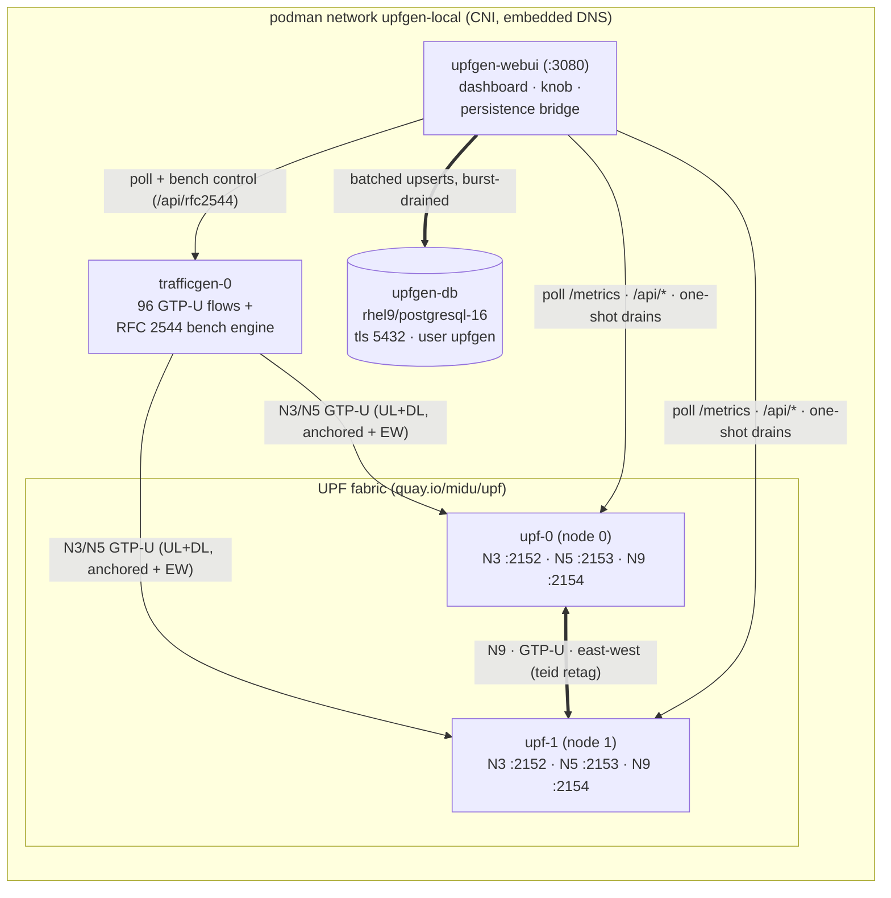
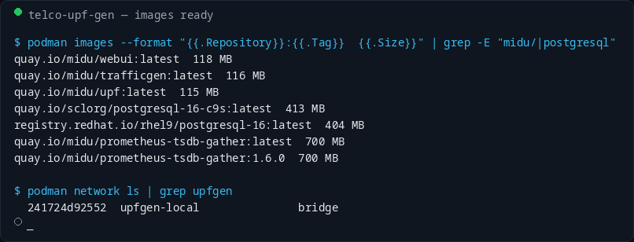
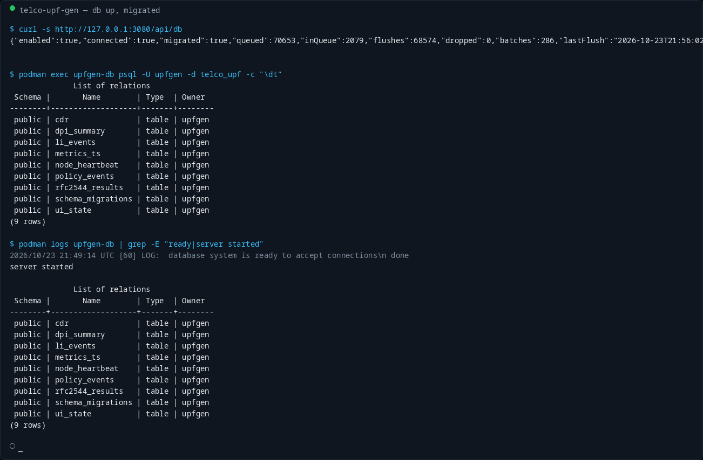
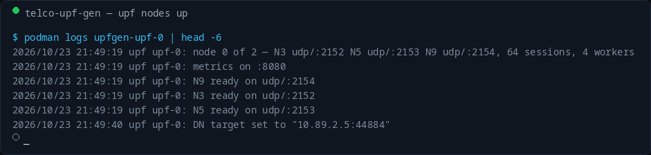
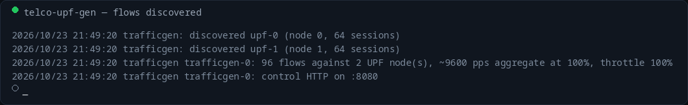
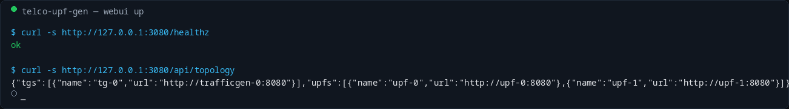
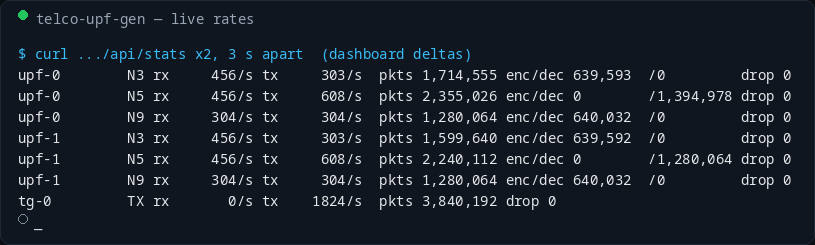
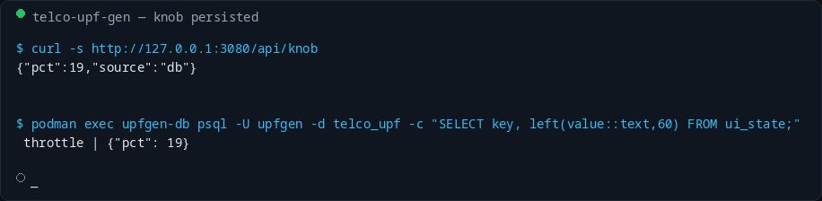
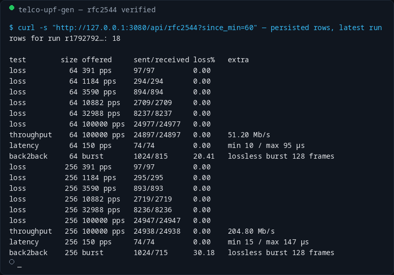
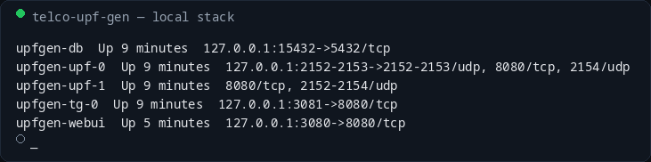

# telco-upf-gen — Podman Local-Stack Demo

Step-by-step demo of the **complete simulator stack in podman containers** —
two UPF nodes, a traffic generator with the **RFC 2544 benchmark engine**,
the Web UI **with its PostgreSQL persistence bridge**, and a real RHEL9
PostgreSQL — on one shared container network.

Everything below was executed for real against a running stack (2026-10-23);
every screenshot is a render of the actual command output captured at that
step. There is no headless browser in this environment — open
`http://127.0.0.1:3080` for the real, animated dashboard; the numbers shown
are the same live values the UI renders.

## Architecture as a container fan



All five containers share one podman CNI network (`upfgen-local`), whose
**embedded container-name DNS** plays the role of OpenShift's headless
Services: `upf-0`/`upf-1` resolve for peer discovery and the webui's
endpoint list, `db` resolves for the store DSN.

The webui is the **only** process with a database connection — the UPF data
plane never touches Postgres, so a DB outage delays reporting only.

## Prerequisites

| Requirement | Note |
|---|---|
| podman ≥ 4 | used: 5.x rootless |
| images | `quay.io/midu/{upf,trafficgen,webui}:latest` — built automatically by `make test-local` (UBI9, dnf-only, uid 1001) |
| DB image | `registry.redhat.io/rhel9/postgresql-16:latest` — pulls via the `DB_AUTHFILE` authfile if not present locally |
| `DB_AUTHFILE` | `~/.docker/config.json` by default; pass the **cluster pull secret** when the local portal creds are stale: `make test-local DB_AUTHFILE=/path/to/pull-secret.json` |
| host ports | webui 3080 · trafficgen 3081 · upf-0 GTP-U UDP 2152/2153 (for external inject) · Postgres 15432 |

Everything in one command:

```bash
make test-local
```

which does: build the three UBI9 images, pull the DB image if missing,
create the network, then start `upfgen-db` → `upfgen-upf-{0,1}` →
`upfgen-tg-0` → `upfgen-webui` in that order.

## Step 00 — images + network

```bash
podman images --format '{{.Repository}}:{{.Tag}}  {{.Size}}' | grep -E 'midu/|postgresql'
podman network ls | grep upfgen
```



*Proof:* all three component images are the UBI9 runtime artifacts built from
this tree (`~115–118 MB` each), and the `upfgen-local` CNI network exists —
with podman's embedded DNS giving every container a `name` A record.

## Step 01 — the stack comes up

```bash
make test-local   # abbreviated output below
```

The Makefile starts Postgres first (migration `001_init.sql` +
`002_rfc2544.sql` are applied by the webui on first connect), then the UPF
nodes, then the generator, then the webui — the same bring-up order
Kubernetes will apply through the deploy phase.

## Step 02 — database connection, migrations, schema

```bash
curl -s http://127.0.0.1:3080/api/db
podman exec upfgen-db psql -U upfgen -d telco_upf -c '\dt'
```



*What you see:* `connected: true, migrated: true` — both migrations applied —
and the nine relations of the store, including `rfc2544_results` (the
benchmark table), `metrics_ts`, `dpi_summary`, `policy_events`, `li_events`,
`cdr`, `node_heartbeat` and `ui_state`. The queue counters show the bridge
keeping up: `dropped: 0`.

## Step 03 — UPF nodes: three GTP-U planes, non-root

```bash
podman logs upfgen-upf-0 | head -6
```



*What you see:* a non-root (uid 1001) process binds **the three GTP-U
interfaces** inside the container — N3 `udp/:2152`, N5 `udp/:2153`,
N9 `udp/:2154` — 64 sessions, 4 forwarding workers. The node ordinal (0)
derives from `POD_NAME`, giving this node its F-TEID space. The last line is
the bench closed-loop in action: the generator set this node's DN target so
benchmark frames get absorbed at the data-network side.

`upf-1` is identical (node 1); from here the fabric is live — each node
resolves its peer over the network DNS and is ready to accept N9 transit.

## Step 04 — traffic generator: discovery + flow plan

```bash
podman logs upfgen-tg-0 | head -4
```



*What you see:* the generator **self-discovered both UPFs** via
`/api/teids` and planned **96 flows**: for each of 32 sessions — anchored N3
uplink, anchored N5 downlink, and east-west flows whose F-TEID embeds the
*peer* anchor node. Solution runs at ~9600 pps aggregate at 100% throttle on
one binary that doubles as the RFC 2544 runner.

## Step 05 — webui is serving dashboard + store

```bash
curl -s http://127.0.0.1:3080/healthz
curl -s http://127.0.0.1:3080/api/topology
```



*What you see:* `ok`, and the fan-out the dashboard will plot: 2 UPF + 1 TG
endpoints, container-DNS addressed. Open **http://127.0.0.1:3080** for the
live dashboard: animated N3/N5/N9 fabric, pod cards with per-interface
tables, knob, CPI/CDR/LI analytics and the RFC 2544 panel.

## Step 06 — live rates: encaps/decap counters under load

```bash
curl -s http://127.0.0.1:3080/api/stats   # sampled twice, 3 s apart
```



*What you see:* the complete stateless fabric in counters — every packet
accounted exactly once:

| Evidence | Value in the shot |
|---|---|
| N3 `encaps` growing | GTP-U capped downlink at the anchor (UL+EW ingest) |
| N5 `decaps` growing | tunnels stripped toward the DN egress |
| N9 rx == N9 tx on both nodes | symmetric east-west transit (retag + forward) |
| `drop` 0 everywhere | lossless under load |
| `tg TX` | what the generator emits (throttle was live at 19 % during capture — see step 07) |

The dashboard draws exactly these deltas, animated, from `/api/stats`.

## Step 07 — the throttle knob persists across restarts

```bash
curl -s http://127.0.0.1:3080/api/knob
podman exec upfgen-db psql -U upfgen -d telco_upf \
  -c "SELECT key, left(value::text,60) FROM ui_state;"
```



*What you see:* `POST /api/knob {"pct":N}` moves every generator's throttle,
**upserts the position into `ui_state`** and the GET answers
`"source":"db"` — on webui restart, generator restart or browser refresh
the exact previous level is re-read from Postgres and re-applied. During
capture the dashboard knob sat at 19 %.

## Step 08 — RFC 2544 benchmark, wired end-to-end

Trigger a compact benchmark (or click **Start** in the RFC 2544 panel):

```bash
curl -s -X POST -H 'Content-Type: application/json' \
  -d '{"frame_sizes":[64,256],"duration_ms":250,"min_rate":500,
       "max_rate":100000,"latency_rate":150,
       "b2b_sizes":[128,1024],
       "tests":["loss","throughput","latency","back2back"]}' \
  http://127.0.0.1:3081/api/rfc2544   # webui also forwards on /api/rfc2544
```

The generator pauses its normal flows, claims the reserved top session
sequence as its closed-loop anchor (inject G-PDU into `upf-0:2152`, sink the
frames at the data-network side via the UPF's runtime `/api/dn-target`
switch), runs the four procedures, then restores the flows. ~35 s later the
webui bridge has upserted the rows — **verified by re-counting them in the
store, not by trusting the enqueue**:

```bash
podman logs upfgen-webui | grep persisting
curl -s "http://127.0.0.1:3080/api/rfc2544?since_min=60"
```



*What you see* (this run, `r1792792…`):

| Procedure | Result in the shot |
|---|---|
| **loss** | 6-point geometric offered-rate ladder per size, `0.00 %` at every rate until the fabric saturates |
| **throughput** | zero-loss maximum — 51.20 Mb/s @64 B, 204.80 Mb/s @256 B (100 k pps, loopback) |
| **latency** | one-way min/max at the light latency rate — 10–147 µs incl. the podman net stack |
| **back2back** | ascending unpaced bursts; lossless-burst length reported per size |

Every row is persisted to `rfc2544_results` (PK `(run_id, test, frame_size,
offered_pps)` — idempotent upsert) and the dashboard's four canvas charts
(loss curves on a log-rate axis, zero-loss throughput bars, latency
min/avg/max, back-to-back) render straight from those rows.

## Step 09 — final state

```bash
podman ps --format '{{.Names}}  {{.Status}}  {{.Ports}}' | grep upfgen
```



Five containers, all `Up`, on one CNI network — the complete distributed UPF
simulator with its persistence and benchmarking, minus the orchestrator.
The dashboard kept running through all steps, driven by the same reports the
cluster deployment will produce.

## What each step proves

| Step | Evidence |
|---|---|
| 00 | UBI9 images are the runtime artifacts; CNI network = headless-service equivalent |
| 01 | one command brings up db → upf → tg → webui in dependency order |
| 02 | both schema migrations applied; store reachable at `db` via container DNS |
| 03 | non-root GTP-U plane binds 2152–2154 with only `NET_BIND_SERVICE` |
| 04 | self-discovery via `/api/teids`; 96 flows incl. all east-west shapes |
| 05 | one dashboard endpoint fans out to every pod |
| 06 | encaps/decap/counter proof: lossless fabric, symmetric N9 |
| 07 | knob: UI → all generators + durable `ui_state`, `"source":"db"` |
| 08 | RFC 2544 closed-loop on the live fabric, rows verified in Postgres |
| 09 | stable five-container state |

## Cleanup

```bash
make local-down   # removes upfgen-db / upf / tg / webui containers + network
```

## Variants

- **More rate:** `TG_PPS=500 make test-local` (token bucket, ~48 k pps here,
  or press the dashboard knob to 100 %).
- **Bigger fabric:** bump the UPF loop in the Makefile (`$i -lt 2` → N),
  set `UPF_NODES`, append endpoints to `UPF_ENDPOINTS`/`TG_ENDPOINTS`
  (F-TEID node bits already cover 0–255).
- **External inject:** upf-0's N3/N5 are published on udp/127.0.0.1:2152–2153 —
  point an external `bin/trafficgen -mode ext` at them, or run another
  generator container anywhere on the network (dual-mode by design).
- **Real DN egress:** `-e DN_TARGET=<host>:<port>` on the UPFs to watch
  decapped plain-IPv4 leave the tunnel (the bench sets this dynamically).
- **Cluster mode:** identical env vars in `deploy/*.yaml`; StatefulSet
  ordinals supply the `POD_NAME`s, headless Services supply the DNS names.
